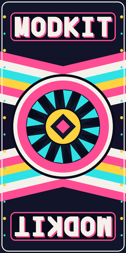

# Example: custom deck graphic (`example.board_graphic`)

A texture-only mod: it gives Tony Hawk's deck an original design (chevron bands, a starburst and "MODKIT" in geometric
block letters). [make_assets.py](make_assets.py) draws the picture from scratch with Pillow shapes; nothing comes from
the game.



## What is in it

| file | |
|---|---|
| `modkit.json` | manifest, format 1: one `skin.deck_graphic` operation |
| `assets/deck.png` | 256 x 512 RGB PNG, 84 KB, portrait: u runs across the deck, v along it |
| `make_assets.py` | regenerates `assets/deck.png` (`--width 128|256|512|1024`, height = 2 x width) |

```json
{"op": "skin.deck_graphic", "skater": "Hawk", "image": "assets/deck.png"}
```

## Size and orientation

A pro's deck graphic is a create-a-skater texture swap: the board's default deck texture is replaced by a `Decks_*` image
when the skater's appearance is built. Tony Hawk's is `Decks_Birdhouse_01`, a **128 x 256 DXT1** portrait image in the
`cas_shared` pak (u across the 0.25 m wide deck, v along its 0.82 m length). The operation keeps that size and format:
the picture is fitted with `fit: cover` (the default), and since this one is also 1:2 it is scaled down without
cropping. The build log says what happened:

```
deck_graphic: Decks_Birdhouse_01 128x256 DXT1 in cas_shared.pak.ps3
```

A bigger deck texture would grow the skater's memory (the `skatergeomheap` budget), which is why the size is not
changed; `size: [w, h]` is there if you have checked the budget, and `rotate` turns a landscape picture. The generator
draws at 4x and filters down, and its `--width` changes the source size.

## Build

```
python tools/modkit/modkit.py build examples/board_graphic --mods <install>\mods
```

Measured on the stock game: one pak entry changes, in `cas_shared_vram.pak` (23,860,864 B written, the overlay replaces
whole files); about 17 s. The decoded result was checked: the 128 x 256 texture in the built pack shows the picture.

Not yet tested in the running game ([docs/modding/operations.md](../../docs/modding/operations.md)).
## In game

Built and booted together with the other examples. The board drawn in free skate is the `cas_shared` copy (confirmed in
game with a test griptape), which is the one this example edits; the deck graphic itself has not been seen in game yet,
because the board's underside never faced the test camera.
