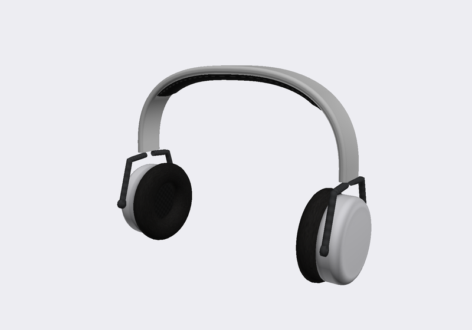

# Example: headphones in Create-a-Skater (`example.cas_headphones`)

A new item for the Create-a-Skater lists, made from your own model. It needs Project 8 Plus with `cas_plus = on`
(the plugin adds the item to the list in the game; the stock game has no way to show new items).

[make_assets.py](make_assets.py) builds `assets/headphones.glb` from scratch, as an original model:
- lathed cups with a rounded rim and a domed cap;
- ring cushions in a leather look around a recessed fabric disc;
- forked yokes on pivots;
- a band with a rounded section and a stitched pad underneath.

It has 9,544 triangles and one 256 x 256 texture: matte surfaces with baked ambient occlusion. The shell is light so
the color rows tint it; the cushions and pads stay dark. The model is left unskinned and the op attaches it to the
head bone. It is fitted to the CAS heads' ear position and skull, and `preview.png` is a render of the file alone.



```json
{"op": "cas.add_item", "id": "headphones", "label": "Headphones", "style": "PUNK", "slot": "Accessory03",
 "gltf": "assets/headphones.glb", "rigid_bone": "Bone_Head", "colourable": true}
```

What the build does, on your machine, from your own game files:

1. It copies a stock item of the punk style as a container (for an accessory slot, the style's first hat: a cloth
   material that takes color, where the metal accessories' material would not) into a new model file,
   `models/skater_male/p8m_example_cas_headphones_headphones.skin`, inside the punk Create-a-Skater pak.
2. It imports the glTF into that copy, the way `skin.replace_part` does: the stock item's meshes are hidden, and the
   headphones and their texture are added.
3. It writes `cas_items.json` into the mod's folder. The plugin reads that file at start-up and appends the item to
   the list (`CAS_PUNK_Accessory03`) when the game loads it.

In the game, the item appears as **HEADPHONES** under TORSO > MISC > CHOOSE MISC ITEMS. It previews on focus, and its
color row (MISC ITEM COLOR) tints the shell. If you disable the mod, the item is gone. A skater who wore it keeps
the slot's default instead.

Fields of `cas.add_item`: see the docstring of [tools/modkit/ops_cas.py](../../tools/modkit/ops_cas.py). The `style`
values are `PUNK`, `URBN`, `SURF`, `KID` and `FEM`. The `slot` values are `Torso`, `Legs`, `Hat`, `Hair`, `Glasses`,
`Socks`, `Accessory01`, `Accessory02`, `Accessory03` and `Shoes`.
