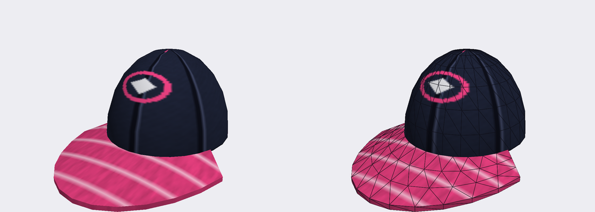

# Example: recolored shirt and a cap (`example.cas_recolor`)

A skater mod in two parts:

1. `skin.recolor` changes the hue, saturation and brightness of Tony Hawk's T-shirt at build time, on your own copy
   of the game. The manifest only says how; the game's picture is never shipped (the mod folder has no texture of
   the shirt).
2. `skin.add_mesh` adds a small original cap that [make_assets.py](make_assets.py) generates (a six-panel crown and a
   curved brim with a cloth texture). The mesh is left unskinned: one rigid node that the operation attaches to a
   bone (`Bone_Head`).



(The picture is a render of the generated file on its own, not of the game.)

## What is in it

| file | |
|---|---|
| `modkit.json` | manifest, format 1: `skin.recolor`, `skin.add_mesh` |
| `assets/cap.glb` | glTF binary, 436 triangles / 312 vertices, 32 KB, one 128x128 cloth texture embedded |
| `make_assets.py` | regenerates `assets/cap.glb` and `preview.png` (`--preview`) |

```json
{"op": "skin.recolor", "skin": "Pro_Hawk", "mesh": 4, "hue": 150, "saturation": 1.9, "value": 1.35},
{"op": "skin.add_mesh", "skin": "Pro_Hawk", "gltf": "assets/cap.glb", "node": "modkit_cap",
 "rigid_bone": "Bone_Head", "offset": [0, 0.03, -0.012], "scale": 1.1}
```

- The shirt. Mesh 4 of `Pro_Hawk` is the T-shirt. Its texture is an atlas shared with the jacket (mesh 0), so the
  operation changes only the texels the shirt's UVs cover (`uv_mask`, on by default). Hue +150 degrees turns the
  shirt and its print to green and blue; the saturation and value factors make it stand out, since the shirt is dark.
  Free skate, skater select and create-a-skater draw Tony Hawk from the `cas_shared` pak, which is where the edit goes.
- The cap. `cap.glb` (Y up, meters, in the human skeleton's bind pose, the skater faces +Z): one node `modkit_cap`, one
  material `modkit_cap_cloth`, normals, `TEXCOORD_0` (inside 0..1), white `COLOR_0`. Crown base at y = 1.765 m, apex at
  1.883 m, the brim reaches z = +0.16 m; `Bone_Head` is near y = 1.65 m. `offset` and `scale` (about the cap's own
  center) settle it on his head. Texture: v < 0.78 is the crown (panel seams at u = k/6, one at the front center
  u = 0.5, an emblem on it), v >= 0.78 the brim. The crown is open at the bottom (the head hides it) and the brim is a
  thin closed sheet. The new mesh gets a material and a texture of its own.

## Build

```
python tools/modkit/modkit.py build examples/cas_recolor --mods <install>\mods
```

Measured on the stock game: 2 files change (`cas_shared.pak` 4,380,928 B and `cas_shared_vram.pak` 23,878,656 B);
`.skin` 188,768 -> 200,320 B, its video memory part 111,316 -> 117,756 B; the largest SPU skinning job 83,552 B
(101 bones) / 85,280 B (128 bones), under the 99,999 B limit; the skater geometry heap 306,000 / 614,400 B main and
1,467,390 / 3,145,728 B video; about 24 s. A render of the built Tony Hawk (the kit's `import_skin.py render`) shows
the cap on his head and the recolored shirt.

Not yet tested in the running game ([docs/modding/operations.md](../../docs/modding/operations.md)).
## In game

Verified in the native port: Tony Hawk wears the cap in skater select and in free skate, sitting on his hair at the
offset and scale given in `modkit.json`, and the T-shirt shows the shifted colors (the jacket covers most of it in
free skate).
