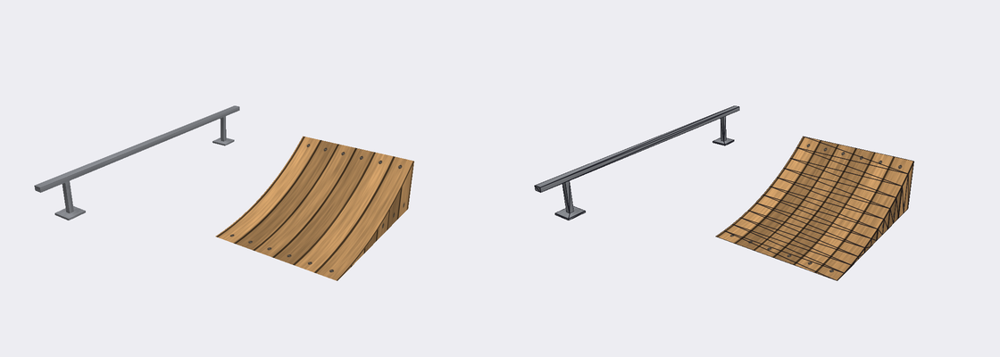

# Example: kicker ramp and grind rail (`example.houses_ramp`)

A static-object mod: an original kicker ramp and a short rectangular grind rail, added to the Houses garage in front of
the free-skate start, with collision for both and a grind line for the rail. Everything in `assets/` is generated by
[make_assets.py](make_assets.py) from scratch (procedural geometry and textures, numpy + Pillow); nothing comes from
the game.



(The picture is a render of the generated file on its own, not of the game.)

## What is in it

| file | |
|---|---|
| `modkit.json` | manifest, format 1: five operations (below) |
| `assets/ramp.glb` | glTF binary, 134 triangles / 204 vertices, 61 KB, two textures embedded (256x256 wood, 128x128 steel) |
| `make_assets.py` | regenerates `assets/ramp.glb` and `preview.png` (`--preview`); `--origin x,y,z` moves the scene |

`ramp.glb` (Y up, meters, the skater rolls along +Z):

| node | size | triangles | vertices | material |
|---|---|---|---|---|
| `modkit_kicker` | 1.2 m wide, 0.5 m high, 1.5 m long (arc radius 2.5 m, 37 degrees at the lip) | 74 | 84 | `modkit_wood` (plank texture) |
| `modkit_rail` | 3.0 m long bar (0.08 x 0.05 m) 0.4 m above the ground, two posts and foot plates; node translated 2 m in +X | 60 | 120 | `modkit_steel` (brushed steel) |

Every vertex has a unit normal, `TEXCOORD_0` (inside 0..1) and a white `COLOR_0`; both materials are single sided.
The rail's grind line is stored on the node as the custom property `thp8_rail_points` (flat `x, y, z` list in the
node's local space), which `nodes.add_rail` reads. Open the file in Blender 4.x (File > Import > glTF) to see the
nodes, the materials and the custom property.

## The operations

| # | operation | what it does |
|---|---|---|
| 0 | `static.add_object` `modkit_kicker` | places the kicker's mesh at `[-61.05, 2.39, -64.52]`, turned 45 degrees, snapped to the floor: 3 m ahead of the free-skate start (`Z_Houses_TRG_Restart_Default` at `[-63.17, 2.39, -66.64]`, facing +X +Z), riding up the spawn's heading |
| 1 | `static.add_object` `modkit_rail` | the rail at `[-61.544, 2.386, -63.317]`, turned the same 45 degrees: 1.3 m to the right of the kicker's lane, 3 m long from 2 m to 5 m ahead of the spawn, inside the garage |
| 2 | `collision.add_mesh` | the kicker's own 74 triangles as collision (terrain `ConcSmooth`, the default) |
| 3 | `collision.add_box` | a box around the rail object (0.2 x 0.4 x 3 m, with its feet) turned by the same yaw |
| 4 | `nodes.add_rail` `modkit_rail_line` | the grind line: two `RailNode`s 3 m apart along the top of the bar (terrain `MetalPole`, the default) |

`position` and `rotation_y` replace the glTF nodes' own transforms, so the file's `+2 m` offset of the rail only
matters in Blender. `nodes.add_rail` has no `snap_to_ground`: its `position` must have the height the static rail
ended up at (the build prints `snap_to_ground: ground at y=2.386, moved by +0.000 m`), which is why the rail's y is
written out.

The placement was checked offline against the zone's geometry: the floor over the whole footprint is flat to within
a few centimeters, nothing stands in the way, and the driveway slopes down from about 6 m ahead of the spawn.

## Build

```
python tools/modkit/modkit.py build examples/houses_ramp --mods <install>\mods
```

Measured on the stock game: 2 files change, `z_houses.pak` 1,898,496 B and `z_houses_vram.pak` 14,852,096 B (the video
memory pak grows by 65,920 B; every zone's link slot grows with it, 0.25 MiB of VRAM in total, predicted free video
memory 58.61 MiB); collision file 540,304 B (+6,624 B); about 20-30 s. The build warns that the zone's video memory pak is
now larger than the stock slot; that is expected.

Not yet tested in the running game ([docs/modding/operations.md](../../docs/modding/operations.md)).
## In game

The kicker and the rail are drawn on the garage floor in front of the free-skate spawn, with no flicker. A test pack of
the collision operations loaded cleanly, and the skater stopped at a new box wall, so new collision works in principle;
riding this kicker and grinding this rail have not been tested in game yet.
